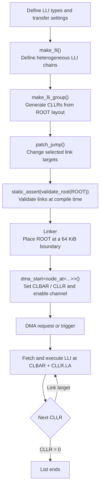

# STM32U5 GPDMA LLI Library

[English](README.en.md) | [日本語](README.md)

## About This Project

This C++20 library builds STM32U575 GPDMA linked lists using `constexpr` and
the type system.

It did not start as a library project. It grew out of personal goals: making
use of the STM32U575 GPDMA, safely combining heterogeneous LLIs, building loop
structures, and minimizing runtime work. The library continues to be developed
for use in the author's own projects.

## Contents

- [Current Scope](#current-scope)
- [Bare-Metal Design Philosophy](#bare-metal-design-philosophy)
  - [Design Goals](#design-goals)
  - [Runtime Behaviour](#runtime-behaviour)
- [Verified Behaviour](#verified-behaviour)
- [Hardware Example: GPIO Looping DMA](#hardware-example-gpio-looping-dma)
- [What `validate_root()` Verifies](#what-validate_root-verifies)
- [Project Status](#project-status)
- [How It Works](#how-it-works)
- [Requirements](#requirements)
- [Basic Example](#basic-example)
- [LLI Placement and DMA Start](#lli-placement-and-dma-start)
- [What `validate_root()` Checks](#what-validate_root-checks)
- [Validation Status and Limitations](#validation-status-and-limitations)
  - [Example of Generated Runtime Code](#example-of-generated-runtime-code)
- [Compile-Only Example](#compile-only-example)
- [License Scope](#license-scope)
- [Development Acknowledgment](#development-acknowledgment)
- [Possible Future Extensions](#possible-future-extensions)

## Current Scope

The current public API includes:

- `make_lli()`
- `make_lli_group()`
- `patch_jump()`
- `node_at<>`
- `validate_root()`
- `dma_set_lli_start()`
- `dma_start()`

The library supports heterogeneous LLIs, constexpr LLI and link generation,
multiple chains, and loops. LLI construction, link editing, and ROOT validation
can be evaluated as constant expressions. `dma_set_lli_start()` and
`dma_start()` configure DMA registers at runtime.

## Bare-Metal Design Philosophy

This library targets bare-metal use of the STM32U5 GPDMA registers. It does not
depend on STM32 HAL DMA APIs or STM32 LL DMA APIs. DMA request/trigger sources
and peripheral configuration remain the application's responsibility.

### Design Goals

- Build LLI structures at compile time
- Validate link structures at compile time
- Minimize runtime DMA start configuration
- Support heterogeneous LLI chains
- Build cyclic links with `patch_jump()`

### Runtime Behaviour

LLI construction, offset calculation, link generation, and structural
validation are performed at compile time whenever possible. At runtime, DMA
start configures CLBAR and CLLR and enables the channel. The inspected machine
code for a specific build is documented in
[Example of Generated Runtime Code](#example-of-generated-runtime-code).

## Verified Behaviour

Hardware verification was performed by directly configuring the STM32U575
registers, without STM32 HAL DMA or LL DMA APIs. The following behaviour was
verified:

- CLLR.LA is an offset from CLBAR, not relative to the current LLI address
- Automatic CLLR generation based on the LLI layout within a ROOT
- Generation of loop links with `patch_jump()` and their execution by DMA

## Hardware Example: GPIO Looping DMA

On STM32U575, GPIO writes were described as LLIs and the link targets were
configured to create this DMA flow. After DMA starts, it executes 0 -> 1 -> 2,
then repeats the loop body 2 -> 3 -> 2 ...:

```text
0: PC7 HIGH
  -> 1: PC7 LOW
  -> 2: PD11 HIGH
  -> 3: PD11 LOW
  -> 2 -> 3 -> 2 ...
```

The ROOT construction below uses application-specific GPIO values, addresses,
and a `make_gpio_write()` helper. That helper is not part of this library; it
is a transfer-descriptor helper defined by the application for its device
configuration.

This example passes one chain to `make_lli_group()`, so its chain index is
`0`. Node indices within that chain are zero-based and follow the order passed
to `make_lli()`. Thus, `node_at<0, 3>` selects the fourth LLI (node 3, PD11
LOW), and `node_at<0, 2>` selects the third LLI (node 2, PD11 HIGH). The
generated links are initially `0 -> 1 -> 2 -> 3`; changing the final link to
`3 -> 2` creates the loop.

```cpp
struct LLI_12BSD_DMA_t
{
    uint32_t CTR1;
    uint32_t CTR2;
    uint32_t CBR1;
    const uint32_t* CSAR;
    uint32_t CDAR;
    uint32_t CLLR;
};

static_assert(sizeof(void*) == sizeof(uint32_t));
static_assert(sizeof(LLI_12BSD_DMA_t) == sizeof(LLI_12BSD_t));
static_assert(offsetof(LLI_12BSD_DMA_t, CLLR) == offsetof(LLI_12BSD_t, CLLR));

constexpr LLI_12BSD_DMA_t make_gpio_write(
    const uint32_t& value,
    uint32_t destination
)
{
    return {
        .CTR1 = 0x0002'4002,
        .CTR2 = 0x010B'0200,
        .CBR1 = 4,
        .CSAR = &value,
        .CDAR = destination,
        .CLLR = 0
    };
}

[[gnu::used]]
[[gnu::section(".lli_data_0")]]
constexpr auto ROOT = [] {
    auto root = make_lli_group(
        make_lli(
            make_gpio_write(GPIO_HIGH_C, GPIOC_BSRR_ADDRESS), //0
            make_gpio_write(GPIO_LOW_C, GPIOC_BSRR_ADDRESS),  //1
            make_gpio_write(GPIO_HIGH_D, GPIOD_BSRR_ADDRESS), //2
            make_gpio_write(GPIO_LOW_D, GPIOD_BSRR_ADDRESS)   //3
        )
    );

    patch_jump<node_at<0, 3>, node_at<0, 2>>(root); // 3 -> 2
    return root;
}();

static_assert(validate_root(ROOT));
```

Configure the request/trigger source (such as the timer trigger) and stop the
DMA channel before starting from the first node in the ROOT:

```cpp
dma_start<node_at<0, 0>>(dma, ROOT);
```

The GPIO initialization waveform visible at the beginning of the logic
analyzer capture occurs before DMA starts; it is not generated by an LLI. After
`dma_start()`, DMA executes LLIs 0 -> 1 -> 2, then follows the links to repeat
nodes 2 and 3. The CPU does not need to update the next node after each LLI.

For this test, a timer configured with a 1 ms period was used as the DMA trigger.


*Verified on STM32U575. After the initial GPIO setup waveform, DMA starts and executes 0 -> 1 -> 2, then repeats the loop body 2 -> 3 -> 2 ... .*

## What `validate_root()` Verifies

`validate_root()` checks that links target existing LLIs within the ROOT and
that offsets, alignment, and CLLR values are structurally valid. Links changed
with `patch_jump()` are also checked.

It does not guarantee successful DMA execution, peripheral configuration,
ROOT placement or DMA memory accessibility, intended state transitions,
reachability, or the absence of dead nodes. Verify those through hardware
testing or separate validation mechanisms. See
[`What validate_root() Checks`](#what-validate_root-checks) for details.

## Project Status

**v1.0**

The current core feature set has been implemented, and the target behavior has
been verified on STM32U575 hardware. "Complete" here means the current core
scope has reached a release point, not that no further improvements are
possible. Future work will continue with additional features, stronger
validation, and documentation.

## How It Works



LLI contents and link targets are prepared before runtime. At runtime, the
library configures the DMA start registers; the GPDMA performs the transfers
and follows the links. DMA request and trigger configuration remains the
application's responsibility.

## Requirements

- A C++20-compatible compiler (`concepts` and `consteval` are used)
- A target with STM32U5 GPDMA; hardware operation has been verified on STM32U575
- STM32 device headers and GPDMA register definitions
- A linker configuration that places each ROOT at a 64 KiB CLBAR boundary
- Each ROOT must fit within 64 KiB

HAL DMA and LL DMA APIs are not required.

The sample was compile-tested with GNU Arm Embedded Toolchain 14.3.1. Other GCC
and Clang versions should be checked for their C++20 support.

The library headers are [`include/gpdma_lli.hpp`](include/gpdma_lli.hpp) and
[`include/gpdma_lli_t.hpp`](include/gpdma_lli_t.hpp). The latter defines the LLI
register-layout types.

## Basic Example

```cpp
#include "gpdma_lli.hpp"

constexpr auto SPI = make_lli(
    LLI_12BSD_t{},
    LLI_1BSD_t{},
    LLI_2D_t{}
);

constexpr auto GPIO = make_lli(
    LLI_12BSD_t{},
    LLI_1BSD_t{}
);

constexpr auto ROOT = [] {
    auto root = make_lli_group(SPI, GPIO);

    // Jump from the last SPI node to the first GPIO node.
    patch_jump<node_at<0, 2>, node_at<1, 0>>(root);

    // Jump from the last GPIO node back to the first SPI node.
    patch_jump<node_at<1, 1>, node_at<0, 0>>(root);

    return root;
}();

static_assert(validate_root(ROOT));
```

The chain and node indices in `node_at<ChainIndex, NodeIndex>` are zero-based.
`make_lli()` defines a chain, and `make_lli_group()` generates linear-link CLLR
values using each LLI's actual offset within the ROOT.

## LLI Placement and DMA Start

CLLR.LA is an offset from the 64 KiB boundary configured in CLBAR, not an
offset relative to the current LLI address. If the ROOT is placed at boundary
address `B`, an LLI at offset `O` within the ROOT is fetched from `B + O`.

```text
64 KiB boundary B (= CLBAR)
|
`-- ROOT (offset 0)
    |-- LLI A --CLLR.LA=0x18--> LLI B at B + 0x18
    |-- ...
    `-- LLI B
        ROOT size <= 0x10000
```

With GNU ld, place the ROOT in a dedicated input section and align its output
section to a 64 KiB boundary:

```cpp
[[gnu::used]]
[[gnu::section(".lli_data_0")]]
constexpr auto ROOT = /* make_lli_group(...) */;

// Call after configuring the request/trigger, while the channel is stopped.
dma_start<node_at<0, 0>>(dma, ROOT);
```

Example GNU ld linker-script section:

```ld
.lli_block_0 ALIGN(0x10000) :
{
  _lli0_start = .;
  KEEP(*(.lli_data_0*))
  . = ALIGN(4);
  _lli0_end = .;
} > ROM
ASSERT((_lli0_end - _lli0_start) <= 0x10000,
       "LLI block exceeds 64KB")
```

`dma_start()` sets CLBAR and CLLR, then enables the channel. It does not
configure DMA requests or triggers, request a stop, or handle status/error
flags; configure those in the caller.

This example places one ROOT block. Placing multiple ROOTs in the same block
does not guarantee that each ROOT is individually aligned. For multiple ROOTs,
use a dedicated input/output section for each ROOT (for example,
`.lli_data_1`) and enforce each section's alignment and size in the linker
script. `dma_start()` does not check placement; it derives CLBAR from the ROOT
address. Verify DMA memory accessibility using the linker configuration and
the target device documentation.

For an STM32U575 linker-script example in this repository, see
[`../STM32U575xx_FLASH.ld`](../STM32U575xx_FLASH.ld).

## What `validate_root()` Checks

`validate_root(ROOT)` checks the LLI layout and link structure inside the ROOT.
It verifies that each CLLR is either a valid terminal value (`0`) or points to
an existing LLI in the ROOT with the expected update flags and offset. Use it
for compile-time validation, for example:

```cpp
static_assert(validate_root(ROOT));
```

It does **not** guarantee:

- That the DMA transfer will complete successfully
- That the ROOT is placed in memory accessible to the DMA
- That linker placement or hardware configuration is correct
- That the link graph implements the application's intended state machine
- That every node is reachable from the selected start node

`CLLR == 0` is treated as a valid terminal link. Detecting unintended
termination or unreachable nodes requires separate validation.

## Validation Status and Limitations

- Constexpr generation and link validation were checked with GNU Arm Embedded
  Toolchain 14.3.1 in C++20 mode.
- ROOT-relative CLLR.LA behavior and a specific GPIO DMA loop were verified on
  STM32U575 hardware.
- Other STM32U5 devices, memory regions, and transfer configurations require
  their own validation.
- A valid LLI layout does not guarantee correct transfer widths, addresses,
  request lines, or other DMA settings.
- `make_lli_group()` and `validate_root()` can be used in constant
  expressions, but ordinary calls do not force compile-time evaluation. Use
  `static_assert(validate_root(ROOT))` or another constant-expression context
  to require compile-time validation.
- `dma_start()` is a runtime function. It configures CLBAR/CLLR and enables the
  channel. ROOT alignment is the linker's responsibility; starting DMA is not
  entirely free of runtime work.

### Example of Generated Runtime Code

The `user_main::userMain()` disassembly was inspected using GNU Arm Embedded
Toolchain 14.3.1, targeting Cortex-M33 with `-Og`. The instructions at
the `dma_start<node_at<0, 0>>(dma, ROOT)` call site were:

```asm
ldr     r2, [pc, ...]       ; ROOT address: 0x08010000
str     r2, [r3, #0x50]     ; CLBAR
ldr     r2, [pc, ...]       ; precomputed CLLR: 0xF8010000
str     r2, [r3, #0xCC]     ; CLLR
ldr     r2, [r3, #0x64]     ; read CCR
orr.w   r2, r2, #1          ; set channel enable
str     r2, [r3, #0x64]     ; write CCR
```

In this build, the inlined `dma_start()` performs no link traversal, CLLR
calculation, alignment check, or function call; CLBAR and CLLR are loaded as
constants. CCR uses a read-modify-write to preserve its other bits. This is
evidence for the specific target, source, and build configuration inspected;
other compilers or optimization settings may generate different instructions.
The surrounding `userMain()` also contains separate initialization and
`delayMs()` calls.

## Compile-Only Example

[`examples/constexpr_example.cpp`](examples/constexpr_example.cpp) demonstrates
ROOT generation, jumps, and validation without requiring hardware. From this
directory, compile it with:

```sh
c++ -std=c++20 -Iinclude -fsyntax-only examples/constexpr_example.cpp
```

This directory also defines the header-only CMake target `gpdma_lli`. To use
the library from another CMake project, add this directory with
`add_subdirectory()` and link the target:

```cmake
add_subdirectory(path/to/gpdma_lli)
target_link_libraries(your_target PRIVATE gpdma_lli)
```

## License Scope

The MIT License in [`LICENSE`](LICENSE) applies to the GPDMA LLI library files
[`include/gpdma_lli.hpp`](include/gpdma_lli.hpp),
[`include/gpdma_lli_t.hpp`](include/gpdma_lli_t.hpp), and
[`examples/constexpr_example.cpp`](examples/constexpr_example.cpp). It does not
apply to STM32Cube, CMSIS, other third-party files, or the firmware project as
a whole; those remain subject to their respective licenses.

When publishing the library as a standalone package, include the library
headers, README files, LICENSE, CMakeLists.txt, and examples from this
directory. Do not mix in STM32Cube/CMSIS vendor files or experimental copies.

## Development Acknowledgment

AI assistance was used during development. Hardware validation and final
design decisions were performed by the author.

## Possible Future Extensions

These are candidates for future feature additions, not requirements for
completing the current core feature set:

- An explicit `patch_end()` API for terminal links
- Graph validation for node reachability
- Utilities for managing multiple ROOTs
- More examples, such as GPIO waveforms, memory copies, and LCD control
