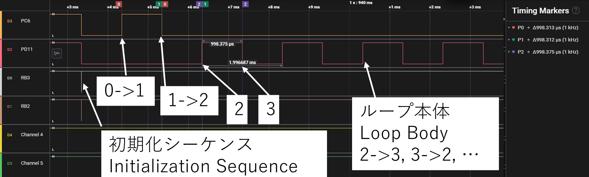
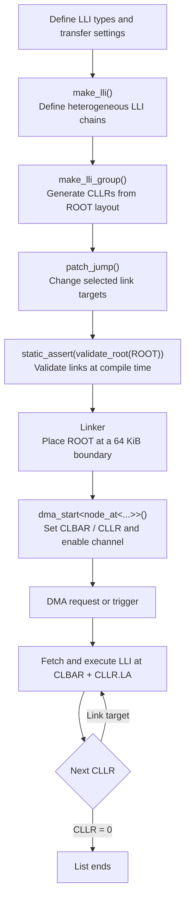

# STM32U5 GPDMA LLI Library

[English](README.en.md) | [日本語](README.md)

## About This Project

This C++20 library builds STM32U575 GPDMA linked lists using `constexpr` and
the type system.

It did not start as a general-purpose library project. It began as a practical
effort to use STM32U575 GPDMA, safely combine heterogeneous LLIs, build loops,
and move list construction and validation to compile time. Manual linked-list
construction can be error-prone; this library grew from solving that problem
and continues to be developed for use in the author's own projects.

## What Problem Does This Solve?

Manually building GPDMA linked lists requires correct CLLR generation,
ROOT-relative offset calculation, placement and alignment management, and
link validation. This library automates those tasks and enables compile-time
validation while preserving direct control of the DMA registers.

## Contents

- [What Problem Does This Solve?](#what-problem-does-this-solve)
- [Current Scope](#current-scope)
- [Recommended Construction Order](#recommended-construction-order)
- [Bare-Metal Design Philosophy](#bare-metal-design-philosophy)
  - [Design Goals](#design-goals)
  - [Runtime Behaviour](#runtime-behaviour)
- [CLLR.LA: Hardware Investigation and Design Rationale](#cllrla-hardware-investigation-and-design-rationale)
- [Verified Behaviour](#verified-behaviour)
- [Hardware Example: GPIO Looping DMA](#hardware-example-gpio-looping-dma)
- [What `validate_root()` Verifies](#what-validate_root-verifies)
- [Project Status](#project-status)
- [How It Works](#how-it-works)
- [Requirements](#requirements)
- [Basic Example](#basic-example)
- [LLI Placement and DMA Start](#lli-placement-and-dma-start)
  - [ROOT and the CLBAR Address Space](#root-and-the-clbar-address-space)
- [What `validate_root()` Checks](#what-validate_root-checks)
- [Validation Status and Limitations](#validation-status-and-limitations)
  - [Example of Generated Runtime Code](#example-of-generated-runtime-code)
- [Compile-Only Example](#compile-only-example)
- [License Scope](#license-scope)
- [Development Acknowledgment](#development-acknowledgment)
- [Possible Future Extensions](#possible-future-extensions)

## Current Scope

The current public API includes:

- `make_lli()`
- `make_lli_group()`
- `patch_jump()`
- `node_at<>`
- `validate_root()`
- `dma_set_lli_start()`
- `dma_start()`

The library supports heterogeneous LLIs, constexpr LLI and link generation,
multiple chains, and loops. LLI construction, link editing, and ROOT validation
can be evaluated as constant expressions. `dma_set_lli_start()` and
`dma_start()` configure DMA registers at runtime.

### Recommended Construction Order

Links are patched after the ROOT is created. Use this order:

1. Define chains with `make_lli()`.
2. Create the ROOT with `make_lli_group()`, which generates the initial linear links.
3. Change selected targets with `patch_jump()` as needed.
4. Validate the link structure with `validate_root(ROOT)`.

The recommended usage is to define ROOT as a `constexpr` object and validate
it at compile time with `static_assert(validate_root(ROOT))`.

## Bare-Metal Design Philosophy

This library targets bare-metal use of the STM32U5 GPDMA registers. It does not
depend on STM32 HAL DMA APIs or STM32 LL DMA APIs. DMA request/trigger sources
and peripheral configuration remain the application's responsibility,
including channel configuration, request sources, priorities, and triggers.
The library does not hide GPDMA features behind an abstraction: users retain
direct control of LLI register fields such as CTR1/2/3 and CBR1/2.

### Design Goals

- Build LLI structures at compile time
- Validate link structures at compile time
- Minimize runtime DMA start configuration
- Support heterogeneous LLI chains
- Build cyclic links with `patch_jump()`

### Runtime Behaviour

LLI construction, offset calculation, link generation, and structural
validation are performed at compile time whenever possible. At runtime, DMA
start configures CLBAR and CLLR and enables the channel. The inspected machine
code for a specific build is documented in
[Example of Generated Runtime Code](#example-of-generated-runtime-code).

## CLLR.LA: Hardware Investigation and Design Rationale

The initial design treated `CLLR.LA` as an offset relative to the current LLI
and generated it from the structure offset to the next node. In a simple
linear chain, this produced the same link delta for every node. The STM32U5
reference manual also allowed an interpretation in which the next address is
based on `CLBAR`, so the addressing rule was checked on real STM32U575 hardware
using manually constructed LLIs.

LLIs placed at ROOT-relative offsets `0x18`, `0x30`, and `0x48` executed as a
linear chain when their CLLRs used those offsets. Changing links to form
`B -> D` and `D -> C` also produced the expected loop. This result is
consistent with `CLBAR + LA`, not `Current LLI + LA`. The library therefore
generates `CLLR.LA` as an offset from the beginning of the ROOT.

The API responsibilities follow this result: `make_lli()` defines a chain
without generating CLLR values; `make_lli_group()` builds the ROOT and
generates links using each node's actual position; `fixup_chain()` writes
CLLR values using ROOT-relative offsets; and `patch_jump()` changes selected
link targets.

## Verified Behaviour

Hardware verification was performed by directly configuring the STM32U575
registers, without STM32 HAL DMA or LL DMA APIs. The following behaviour was
verified:

- CLLR.LA is an offset from CLBAR, not relative to the current LLI address
- Automatic CLLR generation based on the LLI layout within a ROOT
- Construction and execution of chains containing heterogeneous LLIs
- Generation of loop links with `patch_jump()` and their execution by DMA

## Hardware Example: GPIO Looping DMA

On STM32U575, GPIO writes were described as LLIs and the link targets were
configured to create this DMA flow. After DMA starts, it executes 0 -> 1 -> 2,
then repeats the loop body 2 -> 3 -> 2 ...:

```text
0: PC7 HIGH
  -> 1: PC7 LOW
  -> 2: PD11 HIGH
  -> 3: PD11 LOW
  -> 2 -> 3 -> 2 ...
```

The ROOT construction below uses application-specific GPIO values, addresses,
and a `make_gpio_write()` helper. That helper is not part of this library; it
is a transfer-descriptor helper defined by the application for its device
configuration.

This example passes one chain to `make_lli_group()`, so its chain index is
`0`. Node indices within that chain are zero-based and follow the order passed
to `make_lli()`. Thus, `node_at<0, 3>` selects the fourth LLI (node 3, PD11
LOW), and `node_at<0, 2>` selects the third LLI (node 2, PD11 HIGH). The
generated links are initially `0 -> 1 -> 2 -> 3`; changing the final link to
`3 -> 2` creates the loop.

```cpp
struct LLI_12BSD_DMA_t
{
    uint32_t CTR1;
    uint32_t CTR2;
    uint32_t CBR1;
    const uint32_t* CSAR;
    uint32_t CDAR;
    uint32_t CLLR;
};

static_assert(sizeof(void*) == sizeof(uint32_t));
static_assert(sizeof(LLI_12BSD_DMA_t) == sizeof(LLI_12BSD_t));
static_assert(offsetof(LLI_12BSD_DMA_t, CLLR) == offsetof(LLI_12BSD_t, CLLR));

constexpr LLI_12BSD_DMA_t make_gpio_write(
    const uint32_t& value,
    uint32_t destination
)
{
    return {
        .CTR1 = 0x0002'4002,
        .CTR2 = 0x010B'0200,
        .CBR1 = 4,
        .CSAR = &value,
        .CDAR = destination,
        .CLLR = 0
    };
}

[[gnu::used]]
[[gnu::section(".lli_data_0")]]
constexpr auto ROOT = [] {
    auto root = make_lli_group(
        make_lli(
            make_gpio_write(GPIO_HIGH_C, GPIOC_BSRR_ADDRESS), //0
            make_gpio_write(GPIO_LOW_C, GPIOC_BSRR_ADDRESS),  //1
            make_gpio_write(GPIO_HIGH_D, GPIOD_BSRR_ADDRESS), //2
            make_gpio_write(GPIO_LOW_D, GPIOD_BSRR_ADDRESS)   //3
        )
    );

    patch_jump<node_at<0, 3>, node_at<0, 2>>(root); // 3 -> 2
    return root;
}();

static_assert(validate_root(ROOT));
```

The attributes on this ROOT declaration are GNU toolchain extensions.
`[[gnu::used]]` tells the compiler to emit the variable; it does not determine
its placement or guarantee alignment. `[[gnu::section(".lli_data_0")]]` puts
the ROOT in a named input section, while the linker script determines its
final address. On the linker side, `KEEP()` prevents matching sections from
being removed, and `ALIGN(0x10000)` aligns the output section's start. To
ensure the ROOT itself starts at that boundary, keep only that ROOT in its
dedicated input section and verify its address in the linker map.

In this example, `CSAR` holds the address of the value passed to
`make_gpio_write()`. The referenced object must remain alive throughout the
DMA transfer and reside in memory accessible to the GPDMA. Do not point it at
a stack temporary or an object whose lifetime ends before the DMA finishes.
Also ensure that the `CDAR` destination is valid for the device and DMA
configuration.

Configure the request/trigger source (such as the timer trigger) and stop the
DMA channel before starting from the first node in the ROOT:

```cpp
dma_start<node_at<0, 0>>(dma, ROOT);
```

The GPIO initialization waveform visible at the beginning of the logic
analyzer capture occurs before DMA starts; it is not generated by an LLI. After
`dma_start()`, DMA executes LLIs 0 -> 1 -> 2, then follows the links to repeat
nodes 2 and 3. The CPU does not need to update the next node after each LLI.

For this test, a timer configured with a 1 ms period was used as the DMA trigger.



*Verified on STM32U575. After the initial GPIO setup waveform, DMA starts and executes 0 -> 1 -> 2, then repeats the loop body 2 -> 3 -> 2 ... .*

## What `validate_root()` Verifies

`validate_root()` checks that links target existing LLIs within the ROOT and
that offsets, alignment, and CLLR values are structurally valid. Links changed
with `patch_jump()` are also checked.

It does not guarantee successful DMA execution, peripheral configuration,
ROOT placement or DMA memory accessibility, intended state transitions,
reachability, or the absence of dead nodes. Verify those through hardware
testing or separate validation mechanisms. See
[`What validate_root() Checks`](#what-validate_root-checks) for details.

## Project Status

**v1.0**

The current core feature set has been implemented, and the target behavior has
been verified on STM32U575 hardware. "Complete" here means the current core
scope has reached a release point, not that no further improvements are
possible. Future work will continue with additional features, stronger
validation, and documentation.

## How It Works



LLI contents and link targets are prepared before runtime. At runtime, the
library configures the DMA start registers; the GPDMA performs the transfers
and follows the links. DMA request and trigger configuration remains the
application's responsibility.

## Requirements

- A C++20-compatible compiler (`concepts` and `consteval` are used)
- STM32U575 is the current development and hardware-verification target
- STM32 device headers and GPDMA register definitions
- A linker configuration that places each ROOT at a 64 KiB CLBAR boundary
- Each ROOT must fit within 64 KiB

Other STM32 devices with a compatible GPDMA linked-list architecture may work,
but have not been verified. Operation on other STM32 families is not
guaranteed.

HAL DMA and LL DMA APIs are not required.

The sample was compile-tested with GNU Arm Embedded Toolchain 14.3.1. Other GCC
and Clang versions should be checked for their C++20 support.

The library headers are [`include/gpdma_lli.hpp`](include/gpdma_lli.hpp) and
[`include/gpdma_lli_t.hpp`](include/gpdma_lli_t.hpp). The latter defines the LLI
register-layout types.

## Basic Example

```cpp
#include "gpdma_lli.hpp"

constexpr auto SPI = make_lli(
    LLI_12BSD_t{},
    LLI_1BSD_t{},
    LLI_2D_t{}
);

constexpr auto GPIO = make_lli(
    LLI_12BSD_t{},
    LLI_1BSD_t{}
);

constexpr auto ROOT = [] {
    auto root = make_lli_group(SPI, GPIO);

    // Jump from the last SPI node to the first GPIO node.
    patch_jump<node_at<0, 2>, node_at<1, 0>>(root);

    // Jump from the last GPIO node back to the first SPI node.
    patch_jump<node_at<1, 1>, node_at<0, 0>>(root);

    return root;
}();

static_assert(validate_root(ROOT));
```

### `node_at<>` Indexing Model

`node_at<ChainIndex, NodeIndex>` identifies a node within a ROOT using two
zero-based indices:

- `ChainIndex`: the position of the chain passed to `make_lli_group()`
- `NodeIndex`: the position of the node within that chain

`node_at<>` is not an absolute node index across the entire ROOT.

For example:

```cpp
constexpr auto ROOT = make_lli_group(
    SPI_REINIT, // chain 0: node 0, node 1
    SPI_TX_DAT, // chain 1: node 0
    GPIO_HI     // chain 2: node 0
);
```

The following positions are valid:

```cpp
node_at<0, 0> // First node of SPI_REINIT
node_at<0, 1> // Second node of SPI_REINIT
node_at<1, 0> // First node of SPI_TX_DAT
node_at<2, 0> // First node of GPIO_HI
```

The following positions are invalid:

```cpp
node_at<0, 2> // Chain 0 has no third node
node_at<0, 3> // This does not mean the fourth node in the ROOT
```

`make_lli()` defines one chain, while `make_lli_group()` stores multiple chains
in a ROOT. `patch_jump<FROM, TO>()` and `dma_start<POSITION>()` use this pair of
chain and in-chain node indices.

The current API does not provide flat ROOT-wide addressing such as
`node_at<AbsoluteIndex>`.

## LLI Placement and DMA Start

CLLR.LA is an offset from the 64 KiB boundary configured in CLBAR, not an
offset relative to the current LLI address. If the ROOT is placed at boundary
address `B`, an LLI at offset `O` within the ROOT is fetched from `B + O`.

### ROOT and the CLBAR Address Space

A ROOT represents one CLBAR address space. All LLI nodes referenced by its
links must be in the same 64 KiB CLBAR window, and generated `CLLR.LA` values
are offsets from the ROOT base. Use a separate linker section for each
independent ROOT, for example `.lli_data_0`, `.lli_data_1`, and
`.lli_data_ram`. Placing multiple independent ROOTs into one aligned block
does not align each ROOT individually.

```text
64 KiB boundary B (= CLBAR)
|
`-- ROOT (offset 0)
    |-- LLI A --CLLR.LA=0x18--> LLI B at B + 0x18
    |-- ...
    `-- LLI B
        ROOT size <= 0x10000
```

With GNU ld, place the ROOT in a dedicated input section and align its output
section to a 64 KiB boundary:

```cpp
[[gnu::used]]
[[gnu::section(".lli_data_0")]]
constexpr auto ROOT = /* make_lli_group(...) */;

// Call after configuring the request/trigger, while the channel is stopped.
dma_start<node_at<0, 0>>(dma, ROOT);
```

Example GNU ld linker-script section:

```ld
.lli_block_0 ALIGN(0x10000) :
{
  _lli0_start = .;
  KEEP(*(.lli_data_0*))
  . = ALIGN(4);
  _lli0_end = .;
} > ROM
ASSERT((_lli0_end - _lli0_start) <= 0x10000,
       "LLI block exceeds 64KB")
```

In this repository's linker script, `KEEP(*(.lli_data_0*))` collects input
sections whose names match `.lli_data_0*`. An ordinary `constexpr` variable
does not enter this section just because it is `constexpr`; it would need an
explicit matching section attribute (or another compiler/linker rule that
places it in a matching input section). However, any matching input section
is collected by the wildcard and can share the aligned output block. Keep
each ROOT's matching input section dedicated to that ROOT, and check the
linker map to confirm the ROOT symbol itself is 64 KiB aligned and the ROOT
fits within its window. The block size assertion alone does not prove that
every object inside the block is an independently aligned ROOT.

The library is designed for `constexpr` use, but is not limited to it.
`make_lli_group()` and `patch_jump()` can also be called at runtime to
construct or modify a ROOT; CLLR generation and validation then happen at
runtime as well. Completing the ROOT at compile time avoids runtime
construction work and lets the finished LLI data be passed directly to DMA.
For runtime-created ROOTs, the generated links and memory placement must meet
the same structural assumptions. The application must also ensure that a
ROOT in SRAM remains alive while DMA uses it, that CPU/DMA visibility and any
required cache maintenance are handled, and that the ROOT is placed at a
valid CLBAR boundary. `validate_root()` can participate in constant
evaluation, but an ordinary function call does not force compile-time
validation.

`dma_start()` sets CLBAR and CLLR, then enables the channel. It does not
configure DMA requests or triggers, request a stop, or handle status/error
flags; configure those in the caller. `dma_start()` also does not verify
placement. Check the ROOT address and size in the linker map, and confirm from
the target device documentation that DMA can access the selected memory.

For an STM32U575 linker-script example in this repository, see
[`../STM32U575xx_FLASH.ld`](../STM32U575xx_FLASH.ld).

## What `validate_root()` Checks

`validate_root(ROOT)` answers a focused question: **can the DMA interpret this
link structure?** It verifies that each CLLR is either a valid terminal value
(`0`) or points to an existing LLI in the ROOT with the expected update flags.
It also checks the ROOT-relative offset range and 4-byte alignment, including
links changed by `patch_jump()`.

For example, the following statement requires the link structure to be
validated at compile time:

```cpp
static_assert(validate_root(ROOT));
```

Successful validation does **not** mean that the complete DMA configuration is
correct or that the intended transfer is guaranteed to run. `validate_root()`
is responsible for the consistency of the link structure and CLLRs. The
caller must still confirm:

- That the source and destination addresses and transfer widths meet the
  peripheral requirements
- That the correct DMA request line and trigger are selected
- That the ROOT and transfer data are placed in memory accessible to the DMA
- That linker placement, memory attributes, and cache management are
  appropriate for the target device
- That the link graph implements the application's intended state machine
- That all required nodes are reachable from the selected start node

In other words, `validate_root(ROOT) == true` means that the links are encoded
in a form the DMA can follow. It does not prove that the DMA operation is
correct for the application's purpose.

`CLLR == 0` is treated as a valid terminal link. Detecting unintended
termination or unreachable nodes requires separate validation based on the
application's requirements.

## Validation Status and Limitations

- Constexpr generation and link validation were checked with GNU Arm Embedded
  Toolchain 14.3.1 in C++20 mode.
- ROOT-relative CLLR.LA behavior and a specific GPIO DMA loop were verified on
  STM32U575 hardware.
- Devices other than STM32U575, memory regions, and transfer configurations
  have not been verified. Other devices with the same GPDMA linked-list
  architecture may work, but require individual validation.
- A valid LLI layout does not guarantee correct transfer widths, addresses,
  request lines, or other DMA settings.
- `make_lli_group()` and `validate_root()` can be used in constant
  expressions, but ordinary calls do not force compile-time evaluation. Use
  `static_assert(validate_root(ROOT))` or another constant-expression context
  to require compile-time validation.
- `dma_start()` is a runtime function. It configures CLBAR/CLLR and enables the
  channel. ROOT alignment is the linker's responsibility; starting DMA is not
  entirely free of runtime work.

### Example of Generated Runtime Code

The `user_main::userMain()` disassembly was inspected using GNU Arm Embedded
Toolchain 14.3.1, targeting Cortex-M33 with `-Og`. The instructions at
the `dma_start<node_at<0, 0>>(dma, ROOT)` call site were:

```asm
ldr     r2, [pc, ...]       ; ROOT address: 0x08010000
str     r2, [r3, #0x50]     ; CLBAR
ldr     r2, [pc, ...]       ; precomputed CLLR: 0xF8010000
str     r2, [r3, #0xCC]     ; CLLR
ldr     r2, [r3, #0x64]     ; read CCR
orr.w   r2, r2, #1          ; set channel enable
str     r2, [r3, #0x64]     ; write CCR
```

In this build, the inlined `dma_start()` performs no link traversal, CLLR
calculation, alignment check, or function call; CLBAR and CLLR are loaded as
constants. CCR uses a read-modify-write to preserve its other bits. This is
evidence for the specific target, source, and build configuration inspected;
other compilers or optimization settings may generate different instructions.
The surrounding `userMain()` also contains separate initialization and
`delayMs()` calls.

## Compile-Only Example

[`examples/constexpr_example.cpp`](examples/constexpr_example.cpp) demonstrates
ROOT generation, jumps, and validation without requiring hardware. From this
directory, compile it with:

```sh
c++ -std=c++20 -Iinclude -fsyntax-only examples/constexpr_example.cpp
```

This directory also defines the header-only CMake target `gpdma_lli`. To use
the library from another CMake project, add this directory with
`add_subdirectory()` and link the target:

```cmake
add_subdirectory(path/to/gpdma_lli)
target_link_libraries(your_target PRIVATE gpdma_lli)
```

## License Scope

The MIT License in [`LICENSE`](LICENSE) applies to the GPDMA LLI library files
[`include/gpdma_lli.hpp`](include/gpdma_lli.hpp),
[`include/gpdma_lli_t.hpp`](include/gpdma_lli_t.hpp), and
[`examples/constexpr_example.cpp`](examples/constexpr_example.cpp). It does not
apply to STM32Cube, CMSIS, other third-party files, or the firmware project as
a whole; those remain subject to their respective licenses.

When publishing the library as a standalone package, include the library
headers, README files, LICENSE, CMakeLists.txt, and examples from this
directory. Do not mix in STM32Cube/CMSIS vendor files or experimental copies.

## Development Acknowledgment

AI assistance was used during development. Hardware validation and final
design decisions were performed by the author.

## Possible Future Extensions

These are candidates for future feature additions, not requirements for
completing the current core feature set:

- An explicit `patch_end()` API for terminal links
- Graph validation for node reachability
- Utilities for managing multiple ROOTs
- More examples, such as GPIO waveforms, memory copies, and LCD control
