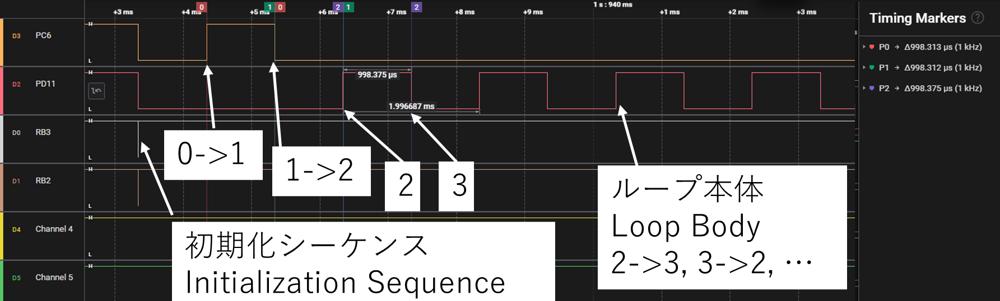
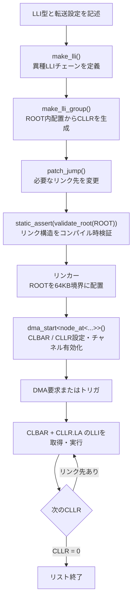

# STM32U5 GPDMA LLI Library

[English](README.en.md) | 日本語

## このプロジェクトについて

このライブラリは、STM32U575のGPDMA Linked Listをconstexprと型システムを利用して構築するためのC++20ライブラリです。

元々はライブラリ開発を目的としたものではなく、STM32U575 GPDMAを活用し、異種LLIを安全に組み合わせ、ループ構造を構築し、実行時処理を最小化するという個人的な課題を解決する過程で作成されました。現在も作者自身のプロジェクトで使用することを前提に開発しています。

## 目次

- [現在の機能](#現在の機能)
- [ベアメタル設計方針](#ベアメタル設計方針)
  - [設計目標](#設計目標)
  - [実行時の動作](#実行時の動作)
- [実機で確認した動作](#実機で確認した動作)
- [実機例: GPIOループDMA](#実機例-gpioループdma)
- [`validate_root()`で確認できること](#validate_rootで確認できること)
- [開発状況](#開発状況)
- [仕組み](#仕組み)
- [必要条件](#必要条件)
- [基本例](#基本例)
- [LLI配置とDMA開始](#lli配置とdma開始)
- [`validate_root()`の責務](#validate_rootの責務)
- [検証状況と制限](#検証状況と制限)
  - [実行時コードの確認例](#実行時コードの確認例)
- [コンパイル確認用サンプル](#コンパイル確認用サンプル)
- [ライセンス範囲](#ライセンス範囲)
- [開発について](#開発について)
- [今後の拡張候補](#今後の拡張候補)

## 現在の機能

現在の公開API:

- `make_lli()`
- `make_lli_group()`
- `patch_jump()`
- `node_at<>`
- `validate_root()`
- `dma_set_lli_start()`
- `dma_start()`

異種LLI混在、constexprによるLLI・リンク生成、複数チェーン、ループ生成をサポートします。LLI構築・リンク編集・ROOT検証は定数式として評価できます。一方、`dma_set_lli_start()`と`dma_start()`は実行時にDMAレジスタを設定するAPIです。

## ベアメタル設計方針

このライブラリはSTM32U5 GPDMAレジスタを直接扱うベアメタル利用を前提としています。STM32 HAL DMA APIやSTM32 LL DMA APIには依存せず、DMA要求・トリガや周辺回路の設定もアプリケーション側で行います。

### 設計目標

- LLI構造をコンパイル時に構築する
- リンク構造をコンパイル時に検証する
- 実行時のDMA開始処理を最小限にする
- 異種LLIを組み合わせる
- `patch_jump()`で循環リンクを構成する

### 実行時の動作

LLI構築、オフセット計算、リンク生成、構造検証は可能な限りコンパイル時に行います。実行時にはDMA開始時にCLBARとCLLRを設定し、チャネルを有効化します。実行時の機械語を特定条件で確認した結果は[実行時コードの確認例](#実行時コードの確認例)を参照してください。

## 実機で確認した動作

実機確認はSTM32U575のレジスタを直接設定して行い、HAL DMA APIやLL DMA APIは使用していません。次の動作を確認しています:

- CLLR.LAが現在のLLIアドレス相対ではなく、CLBAR基準のオフセットであること
- ROOT内配置に基づくCLLR自動生成
- `patch_jump()`によるループリンクの生成とDMA実行

## 実機例: GPIOループDMA

STM32U575上でGPIO出力をLLIにし、リンク先を設定して次のDMAフローを構成しました。DMA開始後、0→1→2を実行し、続いて2→3→2…を繰り返します。

```text
0: PC7 HIGH
  -> 1: PC7 LOW
  -> 2: PD11 HIGH
  -> 3: PD11 LOW
  -> 2 -> 3 -> 2 ...
```

アプリケーション固有の`make_gpio_write()`とGPIOアドレス・値を使ったROOT構築例です。`make_gpio_write()`はこのライブラリのAPIではなく、デバイス設定に合わせてアプリケーション側で定義する転送記述ヘルパーです。

この例では`make_lli_group()`にチェーンを1つだけ渡しているため、チェーン番号は`0`です。そのチェーン内のノード番号は`make_lli()`に渡した順に0始まりで割り当てられます。つまり、`node_at<0, 3>`は4番目のLLI（ノード3、PD11 LOW）、`node_at<0, 2>`は3番目のLLI（ノード2、PD11 HIGH）です。初期リンクは`0→1→2→3`で、最後のリンクを`3→2`に変更してループにしています。

```cpp
struct LLI_12BSD_DMA_t
{
    uint32_t CTR1;
    uint32_t CTR2;
    uint32_t CBR1;
    const uint32_t* CSAR;
    uint32_t CDAR;
    uint32_t CLLR;
};

static_assert(sizeof(void*) == sizeof(uint32_t));
static_assert(sizeof(LLI_12BSD_DMA_t) == sizeof(LLI_12BSD_t));
static_assert(offsetof(LLI_12BSD_DMA_t, CLLR) == offsetof(LLI_12BSD_t, CLLR));

constexpr LLI_12BSD_DMA_t make_gpio_write(
    const uint32_t& value,
    uint32_t destination
)
{
    return {
        .CTR1 = 0x0002'4002,
        .CTR2 = 0x010B'0200,
        .CBR1 = 4,
        .CSAR = &value,
        .CDAR = destination,
        .CLLR = 0
    };
}

[[gnu::used]]
[[gnu::section(".lli_data_0")]]
constexpr auto ROOT = [] {
    auto root = make_lli_group(
        make_lli(
            make_gpio_write(GPIO_HIGH_C, GPIOC_BSRR_ADDRESS), //0
            make_gpio_write(GPIO_LOW_C, GPIOC_BSRR_ADDRESS),  //1
            make_gpio_write(GPIO_HIGH_D, GPIOD_BSRR_ADDRESS), //2
            make_gpio_write(GPIO_LOW_D, GPIOD_BSRR_ADDRESS)   //3
        )
    );

    patch_jump<node_at<0, 3>, node_at<0, 2>>(root); // 3 -> 2
    return root;
}();

static_assert(validate_root(ROOT));
```

タイマトリガなどの要求・トリガ設定を行い、DMAチャネルを停止状態にした後、ROOTの先頭ノードから開始します。

```cpp
dma_start<node_at<0, 0>>(dma, ROOT);
```

ロジックアナライザの先頭に見えるGPIO初期化時の波形は、DMA開始前のGPIO初期化によるもので、LLIの実行ではありません。`dma_start()`の後、DMAがLLI 0→1→2を実行し、その後リンクに従ってノード2と3を繰り返します。CPUがLLIごとに次のノードを更新する必要はありません。

この検証では、1 ms周期に設定したタイマをDMAトリガとして使用しました。



*STM32U575実機で検証済み。冒頭のGPIO初期化波形に続き、`dma_start()`後にDMAが0→1→2を実行し、ループ本体の2→3→2…を繰り返す様子を示します。*

## `validate_root()`で確認できること

`validate_root()`は、ROOT内のリンク先の存在、オフセット範囲、アラインメント、CLLRの整合性を検査します。`patch_jump()`後のリンクも対象です。

DMA実行成功、ペリフェラル設定、ROOTの実アドレスやDMAアクセス可能性、意図した状態遷移、到達可能性、デッドノードの有無は保証しません。これらは実機試験や別の検証機構で確認してください。詳しくは[`validate_root()`の責務](#validate_rootの責務)を参照してください。

## 開発状況

**v1.0**

現在の機能範囲は実装し、STM32U575での対象動作を実機検証済みです。ここでいう完成は今後改善しないという意味ではなく、現在の基本機能を区切ったものです。今後は機能追加、検証強化、ドキュメント整備を続ける予定です。

## 仕組み



LLIの内容とリンク先はビルド時に準備されます。実行時にはDMA開始設定を行い、その後の転送とリンク遷移はGPDMAが実行します。要求線・トリガの設定はアプリケーション側の責務です。

## 必要条件

- C++20対応コンパイラ（`concepts`、`consteval`を使用）
- STM32U5 GPDMAを使用するターゲット。本ライブラリの実機動作確認はSTM32U575で実施
- STM32デバイスヘッダーとGPDMAレジスタ定義
- ROOTをCLBARの64KB境界に配置できるリンカ設定
- ROOT全体が64KiB以内であること

HAL DMA APIおよびLL DMA APIは必要ありません。

サンプルはGNU Arm Embedded Toolchain 14.3.1でコンパイル確認しています。他のGCC/ClangバージョンはC++20対応状況に応じて確認してください。

ライブラリ本体は[`include/gpdma_lli.hpp`](include/gpdma_lli.hpp)と[`include/gpdma_lli_t.hpp`](include/gpdma_lli_t.hpp)です。後者はLLIレジスタレイアウトの型定義を含みます。

## 基本例

```cpp
#include "gpdma_lli.hpp"

constexpr auto SPI = make_lli(
    LLI_12BSD_t{},
    LLI_1BSD_t{},
    LLI_2D_t{}
);

constexpr auto GPIO = make_lli(
    LLI_12BSD_t{},
    LLI_1BSD_t{}
);

constexpr auto ROOT = [] {
    auto root = make_lli_group(SPI, GPIO);

    // SPIの最後からGPIOの先頭へジャンプ
    patch_jump<node_at<0, 2>, node_at<1, 0>>(root);

    // GPIOの最後からSPIの先頭へ戻る
    patch_jump<node_at<1, 1>, node_at<0, 0>>(root);

    return root;
}();

static_assert(validate_root(ROOT));
```

`node_at<ChainIndex, NodeIndex>`の番号はどちらも0始まりです。`make_lli()`はチェーン定義を作り、`make_lli_group()`がROOT内の配置に基づいて直線リンクのCLLRを生成します。

## LLI配置とDMA開始

CLLR.LAは現在のLLIアドレスからの相対値ではなく、CLBARに設定した64KB境界からのオフセットです。例えば、ROOTが境界アドレス`B`に置かれた場合、ROOT内のオフセット`O`にあるLLIは`B + O`からフェッチされます。

```text
64KB境界 B (= CLBAR)
│
├── ROOT (offset 0)
│   ├── LLI A ──CLLR.LA=0x18──> LLI B at B + 0x18
│   ├── ...
│   └── LLI B
└── ROOT size <= 0x10000
```

GNU linkerを使う場合は、ROOTを専用入力セクションへ置き、出力セクションを64KB境界に配置します。

```cpp
[[gnu::used]]
[[gnu::section(".lli_data_0")]]
constexpr auto ROOT = /* make_lli_group(...) */;

// 初期化・トリガ設定後、停止中のDMAチャネルに対して実行
dma_start<node_at<0, 0>>(dma, ROOT);
```

対応するGNU ldリンカースクリプトの例:

```ld
.lli_block_0 ALIGN(0x10000) :
{
  _lli0_start = .;
  KEEP(*(.lli_data_0*))
  . = ALIGN(4);
  _lli0_end = .;
} > ROM
ASSERT((_lli0_end - _lli0_start) <= 0x10000,
       "LLI block exceeds 64KB")
```

`dma_start()`はCLBARとCLLRを設定し、チャネルを有効化します。DMA要求・トリガ設定、停止要求、エラーフラグ処理などは行わないため、呼び出し側で設定してください。

この例は一つのROOT用ブロックを配置します。同じブロックへ複数ROOTを置くと、個々のROOTの境界整列は保証されません。複数ROOTを使う場合は`.lli_data_1`などROOTごとに専用の入力・出力セクションを用意し、それぞれ64KB境界とサイズをリンカースクリプトで保証してください。`dma_start()`は配置チェックを行わず、ROOTアドレスからCLBARを設定します。DMAがそのメモリ領域へアクセス可能かどうかも、リンカー設定やデバイス仕様に基づいて確認してください。

このリポジトリ内のSTM32U575向け配置例は[`../STM32U575xx_FLASH.ld`](../STM32U575xx_FLASH.ld)を参照してください。

## `validate_root()`の責務

`validate_root(ROOT)`はROOT内のLLI配置とリンク構造を検証します。各CLLRが終端(0)か、ROOT内の実在ノードを正しい更新フラグ・オフセットで指しているかを確認します。例えば次のようにコンパイル時検証に使えます。

```cpp
static_assert(validate_root(ROOT));
```

これは次の事項を保証するものではありません:

- DMAが実際に転送を完了すること
- ROOTがDMAアクセス可能なメモリに配置されていること
- リンカ配置やハードウェア設定が正しいこと
- リンク構造がアプリケーションの意図した状態遷移であること
- すべてのノードが開始ノードから到達可能であること

CLLR=0は有効な終端として扱われます。意図しない終端や到達不能ノードの検出は別途実装してください。

## 検証状況と制限

- C++20でのconstexpr生成・リンク検証をGNU Arm Embedded Toolchain 14.3.1で確認
- STM32U575でROOT基準のCLLR.LAと、特定のGPIO DMAループ動作を実機確認
- 他のSTM32U5デバイス、メモリ領域、転送設定については個別の確認が必要
- LLI構造体が正しく生成されても、転送幅・アドレス・要求線などのDMA設定が正しいとは限りません
- `make_lli_group()`と`validate_root()`はconstexpr評価に使えますが、通常の関数呼び出しだけではコンパイル時評価を強制しません。`static_assert(validate_root(ROOT))`などで明示的に検証してください
- `dma_start()`は実行時関数であり、CLBAR/CLLR設定とチャネル有効化を行います。64KB境界配置はリンカースクリプトの責務です。DMA起動処理全体がゼロランタイムコストという意味ではありません

### 実行時コードの確認例

GNU Arm Embedded Toolchain 14.3.1、Cortex-M33、`-Og`でビルドした`user_main::userMain()`を逆アセンブルし、`dma_start<node_at<0, 0>>(dma, ROOT)`の呼び出し箇所を確認しました。該当部分は次のとおりです。

```asm
ldr     r2, [pc, ...]       ; ROOT address: 0x08010000
str     r2, [r3, #0x50]     ; CLBAR
ldr     r2, [pc, ...]       ; precomputed CLLR: 0xF8010000
str     r2, [r3, #0xCC]     ; CLLR
ldr     r2, [r3, #0x64]     ; read CCR
orr.w   r2, r2, #1          ; set channel enable
str     r2, [r3, #0x64]     ; write CCR
```

このビルドでは`dma_start()`のインライン展開後に、リンク走査、CLLR生成、境界チェック、関数呼び出しはなく、CLBAR/CLLRの値は定数ロードされています。CCRは有効化ビットを保つためread-modify-writeです。これは特定のターゲット・ソース・ビルド設定での確認結果であり、他のコンパイラや最適化設定でも同じ命令列になることを保証しません。`user_main()`全体には別途、初期化や`delayMs()`の呼び出しもあります。

## コンパイル確認用サンプル

[`examples/constexpr_example.cpp`](examples/constexpr_example.cpp)はハードウェアを使わず、ROOT生成・ジャンプ・検証をコンパイル時に確認する例です。このフォルダから、コンパイラに応じて次のようにコンパイルしてください。

```sh
c++ -std=c++20 -Iinclude -fsyntax-only examples/constexpr_example.cpp
```

このフォルダはCMakeのヘッダー専用ターゲット`gpdma_lli`も定義します。別プロジェクトに組み込む場合は`add_subdirectory()`し、`target_link_libraries(<target> PRIVATE gpdma_lli)`でリンクできます。

## ライセンス範囲

[`LICENSE`](LICENSE)のMIT Licenseは、このGPDMA LLIライブラリとして作成された`include/gpdma_lli.hpp`、`include/gpdma_lli_t.hpp`および`examples/constexpr_example.cpp`に適用します。STM32Cube、CMSIS、その他のサードパーティファイルやファームウェアプロジェクト全体には適用せず、それぞれのライセンスに従います。

ライブラリ単体で公開する際は、このフォルダのライブラリファイル、README、LICENSE、CMakeLists.txt、サンプルだけを公開パッケージに含め、STM32Cube/CMSISのベンダーファイルや実験用コピーを混在させないでください。

## 開発について

開発にはAIの支援を利用しました。実機検証と最終的な設計判断は作者が行っています。

## 今後の拡張候補

以下は現在の基本機能を完成させるための必須項目ではなく、今後の機能追加候補です。

- 終端リンクを明示する`patch_end()`
- 到達可能性を確認するグラフ検証
- 複数ROOTの配置・管理支援
- GPIO波形、メモリコピー、LCD制御などのサンプル
