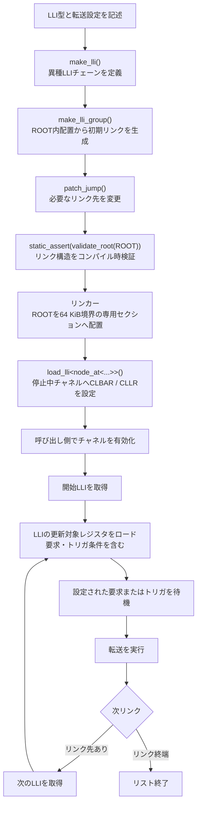

# STM32U5 GPDMA LLI Library

[English](README.en.md) | 日本語

## このプロジェクトについて

このライブラリは、STM32U575のGPDMA Linked Listをconstexprと型システムを利用して構築するためのC++20ライブラリです。汎用ライブラリの開発を出発点としたのではなく、手作業では間違いやすいLLI構築を安全にし、異種LLIやループを扱い、構築と検証をコンパイル時へ移すという実際の開発課題から生まれました。現在も作者自身のプロジェクトで使用しています。

## このライブラリが解決すること

GPDMAのLLIを手作業で構築すると、CLLR生成、ROOT内オフセット計算、配置・アラインメント管理、リンク先の整合性確認が必要です。本ライブラリはこれらを自動化し、コンパイル時検証を可能にしながら、DMAレジスタを直接設定する制御性を保ちます。

## 目次

- [このライブラリが解決すること](#このライブラリが解決すること)
- [現在の機能](#現在の機能)
- [推奨する構築手順](#推奨する構築手順)
- [ベアメタル設計方針](#ベアメタル設計方針)
  - [設計目標](#設計目標)
  - [実行時の動作](#実行時の動作)
- [CLLR.LAの仕様確認と設計の経緯](#cllrlaの仕様確認と設計の経緯)
- [実機で確認した動作](#実機で確認した動作)
- [実機例: GPIOループDMA](#実機例-gpioループdma)
- [`validate_root()`で確認できること](#validate_rootで確認できること)
- [開発状況](#開発状況)
- [仕組み](#仕組み)
- [必要条件](#必要条件)
- [基本例](#基本例)
- [APIの責務](#APIの責務)
    - [本ライブラリが担当する範囲](#本ライブラリが担当する範囲)
    - [本ライブラリが担当しない範囲](#本ライブラリが担当しない範囲)
- [LLI配置とDMA開始](#lli配置とdma開始)
  - [ROOTとCLBAR空間](#rootとclbar空間)
- [`validate_root()`の責務](#validate_rootの責務)
- [検証状況と制限](#検証状況と制限)
  - [実行時コードの確認例](#実行時コードの確認例)
- [コンパイル確認用サンプル](#コンパイル確認用サンプル)
- [ライセンス範囲](#ライセンス範囲)
- [開発について](#開発について)
- [今後の拡張候補](#今後の拡張候補)

## 現在の機能

現在の公開API:

- `make_lli()`
- `make_lli_group()`
- `patch_jump()`
- `node_at<>`
- `validate_root()`
- `load_lli()`

異種LLI混在、constexprによるLLI・リンク生成、複数チェーン、ループ生成をサポートします。LLI構築・リンク編集・ROOT検証は定数式として評価できます。一方、`load_lli()`は停止中のDMAチャネルに対して、ROOTのアドレスをCLBARへ、指定した開始ノードの事前計算済みリンク情報をCLLRへ設定する実行時APIです。チャネルの停止・有効化とROOTの64KB境界配置は、それぞれ呼び出し側とリンカースクリプトが管理します。

### 推奨する構築手順

リンクはROOTを生成した後に修正するため、次の順で構築します。

1. `make_lli()`でチェーンを定義する
2. `make_lli_group()`でROOTを生成し、基本の直線リンクを設定する
3. 必要に応じて`patch_jump()`でリンク先を変更する
4. `validate_root(ROOT)`でリンク構造を検証する

通常はROOTを`constexpr`オブジェクトとして定義し、`static_assert(validate_root(ROOT))`でコンパイル時検証する方法を推奨します。

## ベアメタル設計方針

このライブラリはSTM32U5 GPDMAレジスタを直接扱うベアメタル利用を前提としています。STM32 HAL DMA APIやSTM32 LL DMA APIには依存しません。DMAチャネル、要求元、優先度、トリガ、周辺回路の設定はアプリケーション側で行います。GPDMAの機能を隠す抽象化層ではなく、利用者はLLI内のCTR1/2/3やCBR1/2などのレジスタ値を直接指定できます。

### 設計目標

- LLI構造をコンパイル時に構築する
- リンク構造をコンパイル時に検証する
- 実行時のDMA開始処理を最小限にする
- 異種LLIを組み合わせる
- `patch_jump()`で循環リンクを構成する

#### 実行時の動作

LLI構築、オフセット計算、リンク生成、構造検証は、可能な限りコンパイル時に行います。実行時には、`load_lli()`が停止中のDMAチャネルのCLBARとCLLRを設定します。DMAチャネルの有効化は呼び出し側が行います。特定のビルド条件で生成された機械語については、[実行時コードの確認例](#実行時コードの確認例)を参照してください。

## CLLR.LAの仕様確認と設計の経緯

当初は次ノードまでの構造体内オフセットを使い、`CLLR.LA`を現在のLLIからの相対値として生成する設計でした。単純な直列リンクでは各ノード間の距離が同じため、同じオフセットが繰り返されます。しかし、STM32U5のリファレンスマニュアルの記述から、リンク先は現在のLLIではなく`CLBAR + LA`で求める可能性があると分かり、手書きLLIでSTM32U575実機検証を行いました。

ROOT内のLLIをオフセット`0x18`、`0x30`、`0x48`に配置して対応するCLLRを設定すると、直列リンクが正常に実行されました。さらにリンクを意図的に変更し、`B→D`と`D→C`の循環動作も確認しました。この結果は`Current LLI + LA`では説明できず、`CLBAR + LA`の解釈と一致します。したがって本ライブラリは、`CLLR.LA`をROOT先頭からのオフセットとして生成します。

この検証結果に合わせ、APIの役割を分けています。`make_lli()`はCLLRを生成せずチェーンを定義し、`make_lli_group()`がROOT内の実際のノード配置からリンクを生成します。`fixup_chain()`はROOT基準のオフセットを使って各LLIのCLLRを設定し、`patch_jump()`は必要なリンク先を変更します。

## 実機で確認した動作

実機確認はSTM32U575のレジスタを直接設定して行い、HAL DMA APIやLL DMA APIは使用していません。次の動作を確認しています:

- CLLR.LAが現在のLLIアドレス相対ではなく、CLBAR基準のオフセットであること
- ROOT内配置に基づくCLLR自動生成
- 異種LLIを含むチェーンの構築と実行
- `patch_jump()`によるループリンクの生成とDMA実行

## 実機例: GPIOループDMA

STM32U575上でGPIO出力をLLIにし、リンク先を設定して次のDMAフローを構成しました。DMA開始後、0→1→2を実行し、続いて2→3→2…を繰り返します。

```text
0: PC7 HIGH
  -> 1: PC7 LOW
  -> 2: PD11 HIGH
  -> 3: PD11 LOW
  -> 2 -> 3 -> 2 ...
```

アプリケーション固有の`make_gpio_write()`とGPIOアドレス・値を使ったROOT構築例です。`make_gpio_write()`はこのライブラリのAPIではなく、デバイス設定に合わせてアプリケーション側で定義する転送記述ヘルパーです。

この例では`make_lli_group()`にチェーンを1つだけ渡しているため、チェーン番号は`0`です。そのチェーン内のノード番号は`make_lli()`に渡した順に0始まりで割り当てられます。つまり、`node_at<0, 3>`は4番目のLLI（ノード3、PD11 LOW）、`node_at<0, 2>`は3番目のLLI（ノード2、PD11 HIGH）です。初期リンクは`0→1→2→3`で、最後のリンクを`3→2`に変更してループにしています。

```cpp
struct LLI_12BSD_DMA_t
{
    uint32_t CTR1;
    uint32_t CTR2;
    uint32_t CBR1;
    const uint32_t* CSAR;
    uint32_t CDAR;
    uint32_t CLLR;
};

static_assert(sizeof(void*) == sizeof(uint32_t));
static_assert(sizeof(LLI_12BSD_DMA_t) == sizeof(LLI_12BSD_t));
static_assert(offsetof(LLI_12BSD_DMA_t, CLLR) == offsetof(LLI_12BSD_t, CLLR));

constexpr LLI_12BSD_DMA_t make_gpio_write(
    const uint32_t& value,
    uint32_t destination
)
{
    return {
        .CTR1 = 0x0002'4002,
        .CTR2 = 0x010B'0200,
        .CBR1 = 4,
        .CSAR = &value,
        .CDAR = destination,
        .CLLR = 0
    };
}

[[gnu::used]]
[[gnu::section(".lli_data_0")]]
constexpr auto ROOT = [] {
    auto root = make_lli_group(
        make_lli(
            make_gpio_write(GPIO_HIGH_C, GPIOC_BSRR_ADDRESS), //0
            make_gpio_write(GPIO_LOW_C, GPIOC_BSRR_ADDRESS),  //1
            make_gpio_write(GPIO_HIGH_D, GPIOD_BSRR_ADDRESS), //2
            make_gpio_write(GPIO_LOW_D, GPIOD_BSRR_ADDRESS)   //3
        )
    );

    patch_jump<node_at<0, 3>, node_at<0, 2>>(root); // 3 -> 2
    return root;
}();

static_assert(validate_root(ROOT));
```

このROOT宣言の属性はGNU系ツールチェーンの拡張です。`[[gnu::used]]`はコンパイラに変数を出力させる指定で、配置場所やアドレス整列を保証するものではありません。`[[gnu::section(".lli_data_0")]]`はROOTを指定名の入力セクションへ置きますが、最終アドレスはリンカースクリプトが決めます。リンカースクリプト側の`KEEP()`はリンク時のセクション破棄を防ぎ、`ALIGN(0x10000)`は出力セクションの開始位置を整列します。ROOT自体が出力セクションの先頭にあることは、専用セクションにROOTだけを置くことで保証し、リンクマップでも確認してください。

また、この例の`CSAR`は`make_gpio_write()`へ渡した値のアドレスを保持します。DMA転送中も参照先オブジェクトが存在し、GPDMAからアクセスできるメモリに置かれている必要があります。スタック上の一時オブジェクトや、DMA転送完了前に寿命が終わるオブジェクトを参照させないでください。`CDAR`に指定する転送先についても、デバイスとDMA設定に適したアドレスであることを確認してください。

タイマトリガなどの要求・トリガ設定を行い、DMAチャネルを停止状態にしてからROOTの先頭ノードをロードし、呼び出し側でチャネルを有効化します。

```cpp
dma.CCR &= ~0x0000'0001U;
load_lli<node_at<0, 0>>(dma, ROOT);
dma.CCR |= 0x0000'0001U;
```

`load_lli()`はチャネルを停止・開始しません。`CCR.EN == 1`ではCLBARとCLLRがロックされるため、停止中のチャネルに対して呼び出してください。

ロジックアナライザの先頭に見えるGPIO初期化時の波形は、DMA開始前のGPIO初期化によるもので、LLIの実行ではありません。チャネルを有効化した後、DMAがLLI 0→1→2を実行し、その後リンクに従ってノード2と3を繰り返します。CPUがLLIごとに次のノードを更新する必要はありません。

この検証では、1 ms周期に設定したタイマをDMAトリガとして使用しました。


*STM32U575実機で検証済み。冒頭のGPIO初期化波形に続き、チャネル有効化後にDMAが0→1→2を実行し、ループ本体の2→3→2…を繰り返す様子を示します。*

## `validate_root()`で確認できること

`validate_root()`は、ROOT内のリンク先の存在、オフセット範囲、アラインメント、CLLRの整合性を検査します。`patch_jump()`後のリンクも対象です。

DMA実行成功、ペリフェラル設定、ROOTの実アドレスやDMAアクセス可能性、意図した状態遷移、到達可能性、デッドノードの有無は保証しません。これらは実機試験や別の検証機構で確認してください。詳しくは[`validate_root()`の責務](#validate_rootの責務)を参照してください。

## 開発状況

**v1.1.0**

LLIのロードとDMAチャネルの開始を分離し、`dma_start()`を`load_lli()`へ変更しました。`load_lli()`は、停止中のチャネルへCLBARとCLLRを設定するだけで、チャネルの停止、要求・トリガ設定、有効化はアプリケーション側が管理します。これにより、複数チャネルのLLIを事前にロードし、アプリケーションが指定したタイミングでまとめて有効化できます。

**v1.0**

現在の機能範囲は実装し、STM32U575での対象動作を実機検証済みです。ここでいう完成は今後改善しないという意味ではなく、現在の基本機能を区切ったものです。今後は機能追加、検証強化、ドキュメント整備を続ける予定です。

## 仕組み



各LLIは、転送設定に加えてDMA要求線やトリガ条件も更新できます。そのため、リンクを進むごとに異なる周辺回路要求やタイマトリガへ切り替え、単純なメモリ転送列だけでなく、イベント駆動の状態機械として動作する転送シーケンスも構成できます。これにより、チャネル有効化後はCPUの継続的な介入に依存せず、GPDMAが各LLIの条件に従って要求・トリガ待機、転送、リンク遷移を実行できます。

LLIの内容とリンク先はビルド時に生成されます。実行時には、`load_lli()`が停止中のDMAチャネルへ開始LLIのCLBARとCLLRを設定します。DMA要求線、トリガ条件、およびチャネルの有効化はアプリケーション側で管理します。

## 必要条件

- C++20対応コンパイラ（`concepts`、`consteval`を使用）
- 現在の開発・実機検証対象はSTM32U575
- STM32デバイスヘッダーとGPDMAレジスタ定義
- ROOTをCLBARの64KB境界に配置できるリンカ設定
- ROOT全体が64KiB以内であること

同じGPDMA Linked List機構を持つ他のSTM32デバイスでも利用できる可能性はありますが、STM32U575以外では検証していません。他のSTM32ファミリでの動作は保証対象外です。

HAL DMA APIおよびLL DMA APIは必要ありません。

サンプルはGNU Arm Embedded Toolchain 14.3.1でコンパイル確認しています。他のGCC/ClangバージョンはC++20対応状況に応じて確認してください。

ライブラリ本体は[`include/gpdma_lli.hpp`](include/gpdma_lli.hpp)と[`include/gpdma_lli_t.hpp`](include/gpdma_lli_t.hpp)です。後者はLLIレジスタレイアウトの型定義を含みます。

## 基本例

```cpp
#include "gpdma_lli.hpp"

constexpr auto SPI = make_lli(
    LLI_12BSD_t{},
    LLI_1BSD_t{},
    LLI_2D_t{}
);

constexpr auto GPIO = make_lli(
    LLI_12BSD_t{},
    LLI_1BSD_t{}
);

constexpr auto ROOT = [] {
    auto root = make_lli_group(SPI, GPIO);

    // SPIの最後からGPIOの先頭へジャンプ
    patch_jump<node_at<0, 2>, node_at<1, 0>>(root);

    // GPIOの最後からSPIの先頭へ戻る
    patch_jump<node_at<1, 1>, node_at<0, 0>>(root);

    return root;
}();

static_assert(validate_root(ROOT));
```

### `node_at<>`のインデックス体系

`node_at<ChainIndex, NodeIndex>`は、ROOT内のノード位置を次の2段階で表します。

- `ChainIndex`: `make_lli_group()`へ渡したチェーンの番号
- `NodeIndex`: 対象チェーン内でのノード番号

どちらも0始まりです。`node_at<>`はROOT全体を通した絶対ノード番号ではありません。

例えば、次のROOTを定義した場合:

```cpp
constexpr auto ROOT = make_lli_group(
    SPI_REINIT, // chain 0: node 0, node 1
    SPI_TX_DAT, // chain 1: node 0
    GPIO_HI     // chain 2: node 0
);
```

有効な位置指定は次のとおりです。

```cpp
node_at<0, 0> // SPI_REINITの先頭ノード
node_at<0, 1> // SPI_REINITの2番目のノード
node_at<1, 0> // SPI_TX_DATの先頭ノード
node_at<2, 0> // GPIO_HIの先頭ノード
```

次の指定は無効です。

```cpp
node_at<0, 2> // chain 0に3番目のノードは存在しない
node_at<0, 3> // ROOT全体の4番目のノードという意味にはならない
```

`make_lli()`は1つのチェーンを定義し、`make_lli_group()`は複数のチェーンをROOTへ格納します。`patch_jump<FROM, TO>()`および`load_lli<POSITION>()`では、このチェーン番号とチェーン内ノード番号の組を使用します。

`node_at<AbsoluteIndex>`のようなROOT全体のフラットアドレッシングは、現在のAPIにはありません。

## APIの責務

### 本ライブラリが担当する範囲

- LLI構造の構築
- リンク生成
- リンク構造の検証
- CLBAR/CLLRのロード

### 本ライブラリが担当しない範囲

- DMAチャネルの開始
- DMAチャネルの停止
- DMA要求線の設定
- 周辺回路の設定

これらの処理はアプリケーション側の責務です。

## LLI配置とDMA開始

CLLR.LAは現在のLLIアドレスからの相対値ではなく、CLBARに設定した64KB境界からのオフセットです。例えば、ROOTが境界アドレス`B`に置かれた場合、ROOT内のオフセット`O`にあるLLIは`B + O`からフェッチされます。

### ROOTとCLBAR空間

ROOTは1つのCLBARアドレス空間を表します。ROOTに属するすべてのLLIは同一の64KB CLBARウィンドウ内に置き、`CLLR.LA`はROOT先頭からのオフセットとして扱います。独立したROOTごとに専用セクションを用意するのが推奨です。

```text
ROOT0     → .lli_data_0
ROOT1     → .lli_data_1
ROOT_RAM  → .lli_data_ram
```

このリポジトリのリンカースクリプトは、たとえば`KEEP(*(.lli_data_0*))`で名前が`.lli_data_0*`に一致する入力セクションを`.lli_block_0`へ集めます。通常の`constexpr`変数が`constexpr`であることだけを理由にこのセクションへ入ることはありません。明示的なsection属性や別のコンパイラ・リンカールールにより、一致する入力セクションへ置かれたものだけが対象です。

ただし、一致するセクションに複数のオブジェクトがあると、同じ64KBブロック内にまとめられます。ブロックの先頭が64KB境界に揃っていても、個々のROOTがそれぞれ境界に揃うとは限りません。ROOT専用のセクションにはそのROOTだけを置き、リンクマップでROOTシンボル自体の64KB境界とROOTサイズが64KB以内であることを確認してください。サイズASSERTだけでは、ブロック内の各オブジェクトが個別に整列していることまでは保証しません。

このライブラリは`constexpr`での利用を推奨しますが、`constexpr`専用ではありません。`make_lli_group()`や`patch_jump()`を実行時に呼び出してROOTを構築・変更することもできます。その場合、CLLR生成や検証も実行時に行われます。コンパイル時にROOTを完成させることで、実行時の構築処理を避け、完成したLLIデータをそのままDMAに渡せます。実行時に作るROOTについては、生成されたリンクとメモリ配置が同じ構造上の前提を満たすことに加え、SRAM上のROOTがDMA開始まで有効な状態で存在すること、CPUとDMA間の可視性・必要なキャッシュ処理、正しいCLBAR境界への配置をアプリケーション側で保証してください。`validate_root()`はconstexpr評価も可能ですが、通常の関数呼び出しを自動的にコンパイル時検証へ変えるものではありません。

```text
64KB境界 B (= CLBAR)
│
├── ROOT (offset 0)
│   ├── LLI A ──CLLR.LA=0x18──> LLI B at B + 0x18
│   ├── ...
│   └── LLI B
└── ROOT size <= 0x10000
```

GNU linkerを使う場合は、ROOTを専用入力セクションへ置き、出力セクションを64KB境界に配置します。

```cpp
[[gnu::used]]
[[gnu::section(".lli_data_0")]]
constexpr auto ROOT = /* make_lli_group(...) */;

// 初期化・トリガ設定後、停止中のDMAチャネルに対して実行
load_lli<node_at<0, 0>>(dma, ROOT);

// 必要なチャネルをすべて準備した後、呼び出し側で有効化
dma.CCR |= 0x0000'0001U;
```

対応するGNU ldリンカースクリプトの例:

```ld
.lli_block_0 ALIGN(0x10000) :
{
  _lli0_start = .;
  KEEP(*(.lli_data_0*))
  . = ALIGN(4);
  _lli0_end = .;
} > ROM
ASSERT((_lli0_end - _lli0_start) <= 0x10000,
       "LLI block exceeds 64KB")
```

`load_lli()`はCLBARとCLLRだけを設定し、チャネルを停止・開始しません。`CCR.EN == 1`では両レジスタがロックされるため、停止中のチャネルに対して呼び出してください。DMA要求・トリガ設定、停止・開始、エラーフラグ処理は呼び出し側の責務です。配置チェックも実行しないため、リンクマップでROOTのアドレスとサイズを確認し、DMAがそのメモリ領域へアクセスできることをデバイス仕様に基づいて確認してください。

このリポジトリ内のSTM32U575向け配置例は[`../STM32U575xx_FLASH.ld`](../STM32U575xx_FLASH.ld)を参照してください。

## `validate_root()`の責務

`validate_root(ROOT)`が確認するのは、**DMAがこのリンク構造を解釈できるか**という点です。各CLLRが終端（`0`）か、ROOT内の実在ノードを正しい更新フラグで指しているかに加え、ROOT基準オフセットが`0xFFFC`以内であることと4バイトアラインメントを検査します。`patch_jump()`で変更したリンクも対象です。

例えば、次の記述によってリンク構造の検証をコンパイル時に要求できます。

```cpp
static_assert(validate_root(ROOT));
```

ここで検証に成功しても、**DMA設定全体が正しく、意図した転送が必ず行われるという意味ではありません**。`validate_root()`はリンク構造とCLLRの整合性を担当し、次の事項は呼び出し側で確認する必要があります。

- 転送元・転送先アドレスと転送幅が周辺機器の要件に合っていること
- 適切なDMA要求線とトリガーが選択されていること
- ROOTおよび転送対象がDMAからアクセス可能なメモリに配置されていること
- リンカ配置、メモリ属性、キャッシュ管理が対象デバイスに適していること
- リンク構造がアプリケーションの意図した状態遷移になっていること
- 必要なノードが選択した開始ノードから到達可能であること

言い換えると、`validate_root(ROOT) == true`は「DMAがたどれる形式のリンクである」ことを示しますが、「そのDMA処理が用途として正しい」ことまでは保証しません。

`CLLR == 0`は有効な終端として扱われます。意図しない終端や到達不能ノードの検出は、アプリケーションの要件に応じて別途行ってください。

## 検証状況と制限

- C++20でのconstexpr生成・リンク検証をGNU Arm Embedded Toolchain 14.3.1で確認
- STM32U575でROOT基準のCLLR.LAと、特定のGPIO DMAループ動作を実機確認
- STM32U575以外のデバイス、メモリ領域、転送設定は未検証です。同じGPDMA Linked List機構を持つデバイスで利用できる可能性はありますが、個別の確認が必要です
- LLI構造体が正しく生成されても、転送幅・アドレス・要求線などのDMA設定が正しいとは限りません
- `make_lli_group()`と`validate_root()`はconstexpr評価に使えますが、通常の関数呼び出しだけではコンパイル時評価を強制しません。`static_assert(validate_root(ROOT))`などで明示的に検証してください
- `load_lli()`は実行時関数であり、停止中のチャネルのCLBAR/CLLRだけを設定します。チャネル有効化と64KB境界配置は、それぞれ呼び出し側とリンカースクリプトの責務です

### 実行時コードの確認例

GNU Arm Embedded Toolchain 14.3.1、Cortex-M33、`-Og`でビルドした`user_main::userMain()`を逆アセンブルし、停止中のチャネルへのLLIロードを確認しました。該当部分は次のとおりです。

```asm
80035ee: 4a07        ldr     r2, [pc, #28]   ; 0x08010000: ROOT address
80035f0: 651a        str     r2, [r3, #80]   ; CLBAR
80035f2: 4a07        ldr     r2, [pc, #28]   ; 0xF8010000: start CLLR
80035f4: f8c3 20cc   str.w   r2, [r3, #204]  ; CLLR
```

リテラルプールには、CLBARへ設定するROOTアドレス`0x08010000`と、`node_at<0, 0>`から生成された開始用CLLR`0xF8010000`が格納されていました。このビルドでは`load_lli()`がインライン展開され、CLBARとCLLRへの2回のストア命令になっています。

これは現在のソースと特定のターゲット・ツールチェーン・ビルド設定で得られた結果です。ソースの変更、リンク位置、コンパイラ、最適化設定によって、アドレス、レジスタ、命令形式は変わる可能性があります。

## コンパイル確認用サンプル

[`examples/constexpr_example.cpp`](examples/constexpr_example.cpp)はハードウェアを使わず、ROOT生成・ジャンプ・検証をコンパイル時に確認する例です。このフォルダから、コンパイラに応じて次のようにコンパイルしてください。

```sh
c++ -std=c++20 -Iinclude -fsyntax-only examples/constexpr_example.cpp
```

このフォルダはCMakeのヘッダー専用ターゲット`gpdma_lli`も定義します。別プロジェクトに組み込む場合は`add_subdirectory()`し、`target_link_libraries(<target> PRIVATE gpdma_lli)`でリンクできます。

## ライセンス範囲

[`LICENSE`](LICENSE)のMIT Licenseは、このGPDMA LLIライブラリとして作成された`include/gpdma_lli.hpp`、`include/gpdma_lli_t.hpp`および`examples/constexpr_example.cpp`に適用します。STM32Cube、CMSIS、その他のサードパーティファイルやファームウェアプロジェクト全体には適用せず、それぞれのライセンスに従います。

ライブラリ単体で公開する際は、このフォルダのライブラリファイル、README、LICENSE、CMakeLists.txt、サンプルだけを公開パッケージに含め、STM32Cube/CMSISのベンダーファイルや実験用コピーを混在させないでください。

## 開発について

開発にはAIの支援を利用しました。実機検証と最終的な設計判断は作者が行っています。

## 今後の拡張候補

以下は現在の基本機能を完成させるための必須項目ではなく、今後の機能追加候補です。

- 終端リンクを明示する`patch_end()`
- 到達可能性を確認するグラフ検証
- 複数ROOTの配置・管理支援
- GPIO波形、メモリコピー、LCD制御などのサンプル
